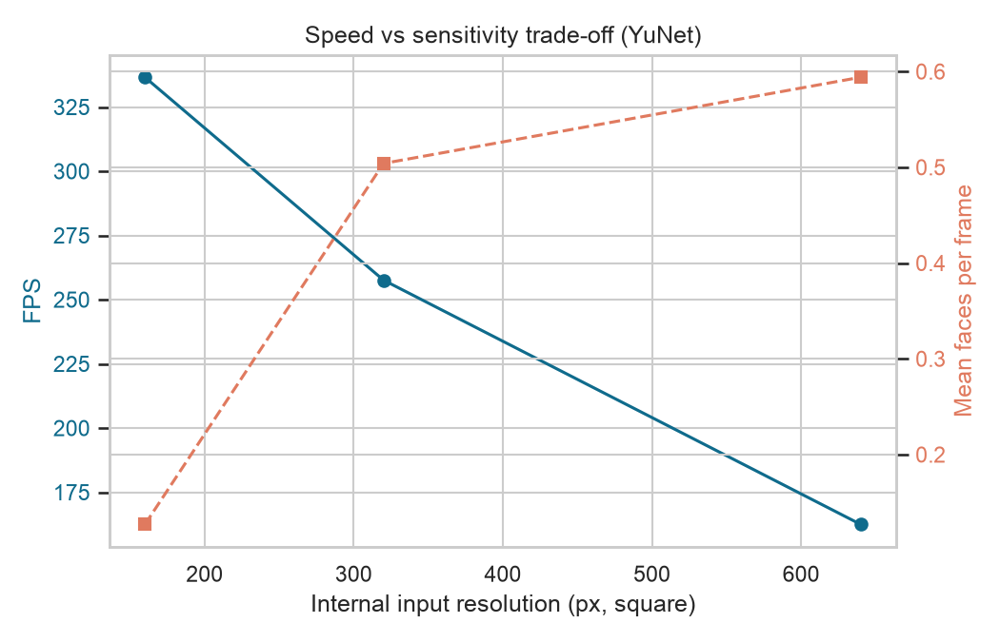
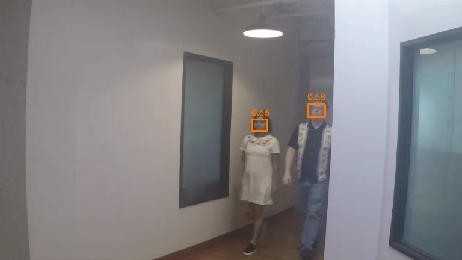

# 😀 Real-Time Face Detection System

Real-time face detection with **YuNet** — OpenCV's current deep-learning face detector (ONNX) —
including a full benchmark of the **speed vs detection count trade-off** across input resolutions,
plus a live webcam application.

- **Modern stack:** OpenCV 5.x · YuNet (ONNX, 232 KB) · no legacy Haar cascades
- **Benchmark:** 732-frame real video, honest FPS + detection stats
- **Demo:** real-time webcam detection with FPS overlay

---

## 🚀 Quick start

```bash
# 1. install deps
pip install -r requirements.txt

# 2. download the YuNet model (232 KB)
bash scripts/download_assets.sh

# 3a. run the benchmark
python src/benchmark.py --save-sample-frame

# 3b. OR run the live webcam demo
python scripts/webcam_detect.py --size 320   # press q / ESC to quit
```

---

## 📈 Benchmark results (speed vs detection count)

Tested on a 732-frame sample video (1920×1080, people walking). Measured on this machine:

| Config | FPS | Mean faces/frame | Frames with detection | Mean confidence |
|---|---|---|---|---|
| YuNet **160×160** | **339** | 0.13 | 75/732 | 0.76 |
| YuNet **320×320** | 258 | 0.50 | 221/732 | 0.80 |
| YuNet **640×640** | 162 | **0.59** | **273/732** | **0.83** |



The 320-pixel setting processed 258 FPS and produced detections in 221 frames. See the [recorded benchmark](reports/benchmark.json) for all three settings.



---

## 📁 Project layout

| Path | What |
|---|---|
| `src/detectors.py` | YuNet wrapper (resolution control, box rescaling) + annotation utils |
| `src/benchmark.py` | Video benchmark → `reports/benchmark.json` |
| `scripts/webcam_detect.py` | Real-time webcam app with FPS overlay |
| `scripts/download_assets.sh` | Fetches the YuNet ONNX model |
| `notebooks/01-benchmark.ipynb` | Executed benchmark walkthrough |
| `models/` | YuNet ONNX model (232 KB) |
| `assets/` | Sample test video (people walking) |
| `images/` | Annotated frames + trade-off plot |

---

## Limitations and next experiment

All three configurations processed the same 732-frame clip. At 160, 320 and 640 pixels, the detector returned boxes in 75, 221 and 273 frames respectively. A person can appear in multiple frames and a box can be a false positive. Manual labels would allow precision and recall estimates. The saved report omits hardware details, so throughput comparisons apply only within this run.

### Run with recorded hardware

On an Apple M4 with OpenCV 5.1.0, the 160-, 320- and 640-pixel settings processed 236, 155 and 59 FPS, respectively. They returned detections in 74, 223 and 273 of the same 732 frames. These are single-run wall-clock measurements. Concurrent workloads can affect throughput. [Hardware and results](reports/hardware_rerun.json)

## 📚 References

- OpenCV Zoo — [face_detection_yunet](https://github.com/opencv/opencv_zoo/tree/main/models/face_detection_yunet)
- Sample video: [intel-iot-devkit/sample-videos](https://github.com/intel-iot-devkit/sample-videos)
